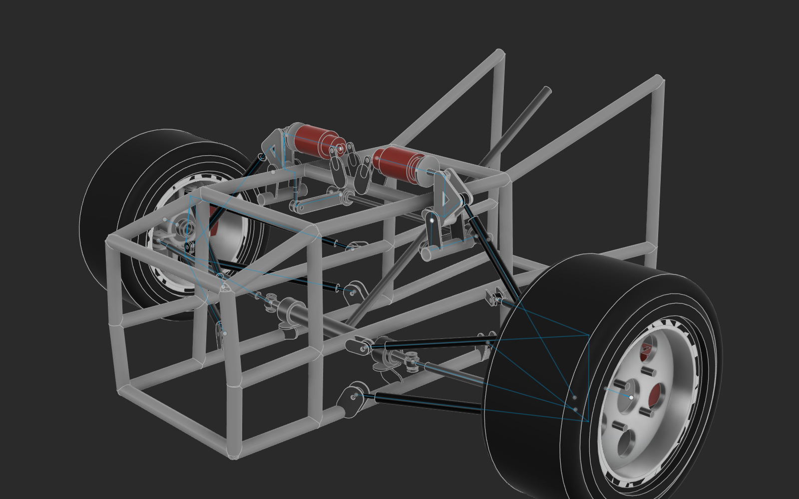

# FSAE-class front suspension

An independent design by Navy Robson (Mechanical Designer, engineering student): a pushrod / rocker / inboard-coilover double-wishbone front suspension for a 10 in FSAE-class car. The code and CAD scripts were written with an AI coding assistant (Claude) to Navy's brief; see the note at the top of [SUMMARY.md](SUMMARY.md). The full write-up is [WRITEUP.md](WRITEUP.md); the one-page summary is [SUMMARY.md](SUMMARY.md).



| | |
|---|---|
| Camber recovery / bump steer / Ackermann | 61.9-62.6 % / 0.0001 deg / 43.8-45 % |
| CAD sweep, 279 poses (heave, roll, steer, warp) | 0 collisions, 0 clearance warnings |
| Fastener sweep (washers, heads, nuts, inserts, tool access; every joint) | 0 FAIL over 712 checks (8 WARN: threads in bought parts, to confirm) |
| Worst buckling FoS / unsprung mass per corner | 2.3 / 10.21 kg |
| Upright FEA (nine load cases): yield FoS / convergence / method vs beam theory | 2.30 / 2.0 % / 0.04 % |
| Upright fatigue (Miner, 3,000 km duty) / mass | factor 3.24 / 0.778 kg, one piece |
| Upright drawing / parts cost per corner | [FS1-UPR-001](drawings/FS1-UPR-001.pdf) / about 3,570 USD ([BOM](notes/bom.md)) |
| Requirements (generated matrix) | 64 pass, 4 deviations, 1 action, 1 retired |

The evidence chain runs requirements -> kinematics -> loads -> CAD -> FEA -> drawings -> DFMEA and test plan -> write-up. Start with [SUMMARY.md](SUMMARY.md); every decision and its alternatives are in [notes/requirements.md](notes/requirements.md).

## How to verify

```bash
pip install -r requirements.txt
python scripts/run_all.py
python -m pytest tests -q
```

Expected:
- `run_all.py` takes 35-45 minutes (the fastener sweep is most of it) and ends with `requirements matrix (v1.7): ACTION 1, DEVIATION 4, PASS 64, RETIRED 1`. Its first line says `upright STEP: stamp current` (or, after a change, that the STEP was reproduced and its stamp renewed).
- The sweep reports `0 collisions, 0 clearance warnings` and the fastener sweep `0 FAIL, 8 WARN over 712 checks`.
- pytest reports `243 passed` (about two and a half minutes).
- `python scripts/stamps.py` prints `every output in data/stamps.json is current` (or what is stale, and why).

What the pipeline refuses (each check has a test in `tests/test_freshness.py` that edits an input and expects the refusal):
- **The upright STEP against its inputs.** `cad/upright/` is a CAD input that `run_all.py` does not regenerate. Its first stage, `stamps.verify_upright`, regenerates the upright in a scratch folder holding only the declared inputs of `scripts/upright/upright_geom.py`, and stamps the committed STEP files only if they are reproduced exactly. This takes under a minute and runs only when an input or the STEP has changed. A STEP older than its inputs, such as a CAD rebuilt without regenerating the upright, stops the run.
- **The CAD meshes against the STEP and their own bytes.** `cad/meshes/index.json` records the CAD fingerprint, the upright STEP the meshes were exported with, and each mesh file's hash. `common.load_mesh_index`, which the interference sweep, the fastener sweep and the mass budget all go through, refuses meshes exported with another STEP (a STEP regenerated without a CAD rebuild) and any swapped, edited or missing mesh. `common.load_mesh` also checks the bytes it parses.
- **Every output against what it was made from.** Each script that `run_all.py` runs stamps its outputs in `data/stamps.json`. The stamp holds the content hash of each input the script read (its data files and the project code it imports) and of each output. A run that reads a data file its declaration in `stamps.PRODUCERS` leaves out fails, so the declarations cannot fall behind the code. `requirements_matrix.py`, and so the DFMEA page and the write-up, refuses to build while any output is stale, any input has changed since, or any output has been edited, following generated inputs back to the script that made them.
- `python scripts/fea/benchmark_cantilever.py` (about 3 minutes) ends with `Result: PASS`; so does `python scripts/fea/benchmark_peaks.py` (a few minutes: a plate with a hole and the cup-seat ring).
- `python scripts/fea/upright_fea.py` (about an hour; it needs most of a 16 GB machine's memory) rebuilds `notes/upright_fea.md`; then `python scripts/fea/upright_fatigue.py` (about 30 minutes) rebuilds `notes/upright_fatigue.md`. The requirements matrix marks the FEA's and the fatigue check's items STALE whenever the upright's geometry, loads, data or FEA code have changed since it ran. The inputs `run_all.py` regenerates (the interface loads, load cases, duty loads and bearing loads) are compared to 7 significant digits, so last-digit differences between machines do not count as a change.
- `python scripts/fea/plot_lc4.py` (about 7 minutes, seconds once cached) redraws the LC4 contour and the upright's hero image, which `WRITEUP.md` needs; `python scripts/drawings/upright_drawing.py` redraws the upright's drawing.

`run_all.py` uses the committed meshes in `cad/meshes` (hardpoints v1.7; `cad/meshes/index.json` holds the input fingerprint, the upright STEP's hash and each mesh's hash), so Fusion is not needed. `.github/workflows/ci.yml` runs the same steps on every push.

## Layout

| Folder | Contents |
|---|---|
| `data/` | **Inputs:**<br>`hardpoints.csv` (single source of truth for geometry; earlier versions kept as `hardpoints_v*.csv`)<br>`vehicle.json` (reference vehicle, damper, brakes, ARB bar, load cases)<br>`members.csv`, `joints.csv`, `joints_misalignment.csv`, `materials.json` (hardware and allowables)<br>`cockpit_envelope.json` (assumed chassis and driver envelope, context only)<br>`upright_design.json` (the detailed upright's sizes, each change with the stress it fixed)<br>`requirements.json` (requirements register)<br>`bom.csv` (parts, prices and sources)<br>**Generated** (each stamped with the hardpoint version):<br>`kinematics_summary.csv`, `sweep_*.csv`, `vehicle_derived.json`, `loadcases.csv`, `member_forces.csv`, `member_checks.csv`, `joint_checks.csv`, `misalignment.csv`, `poses.json`, `interference.csv`, `mass_budget.csv`, `upright_loads.json`, `bearings.json`, `bolt_checks.csv`, `duty_loads.json`, `upright_fea.json`, `upright_fatigue.json`, `handcalc_results.json`, `bom_costed.csv`, `tradeoff_*.csv`, `fea_benchmark.csv`<br>`stamps.json`: what each generated output was made from (`scripts/stamps.py`) |
| `scripts/` | `common.py`: paths, I/O, vector maths, plot style<br>`suspension.py`: kinematic solver for one corner<br>`kinematics.py`: heave, roll and steer sweeps scored against targets<br>`vehicle_calcs.py`: rates, roll, ARB, balance shift and load cases<br>`forces.py`: 6x6 member forces (with the tyre's aligning moment) and FoS checks<br>`upright_loads.py`: hub, caliper and upright free bodies: bearing rows, caliper bolts, ball joints, tie rod; bearing static safety<br>`bearings.py`: hub bearing life over a duty spectrum, cup fits and housing hoop stress<br>`bolts.py`: ball-joint and rod-end bolt bending (lug-pin model)<br>`misalignment.py`: rod-end and ball-joint angles over the envelope<br>`handcalc_lc1.py`: 2D hand-calc method for LC1<br>`handcalcs.py`: twelve hand-calc packets and their answer key (rocker, bracket knee, hub spindle, ARB ends, steering arm, ear roots; brake heat, welds and threads, free play from `week3b_checks.py`)<br>`duty_loads.py`: duty-spectrum loads and cycle counts<br>`bom.py`: the costed BOM<br>`poses.py`: rigid-body poses for the CAD<br>`interference.py`: CAD mesh collision and clearance sweep, joint rules per body<br>`fasteners.py`: washers, heads, nuts and inserts of the bolts between designed parts through the same poses, plus tool and insertion-path access (S-18)<br>`mass_budget.py`: CAD masses and unsprung mass<br>`requirements_matrix.py`: the generated requirements status<br>`dfmea.py`: the DFMEA and test plan (`data/dfmea.json` -> `notes/dfmea.md`), checked against the matrix<br>`fingerprint.py`: the CAD-input fingerprint and the mesh and upright STEP hashes (shared with the Fusion jobs)<br>`stamps.py`: each output's stamp (the content of what it was made from), the check that refuses stale ones, and the upright STEP's check by regeneration<br>`rim_clearance.py`: fast analytic rim-vs-link check<br>`tune_hardpoints.py`, `tradeoff_rc_camber.py`, `probe_rc_vs_chassis_width.py`: optimisation and trade studies, run on demand<br>`upright/upright_geom.py`: the detailed upright as code (OpenCASCADE through gmsh), written as STEP for Fusion and the FEA<br>`drawings/`: `upright_drawing.py` (the GD&T drawing from the STEP: `sheet.py` sheet and GD&T symbols, `views.py` views and sections)<br>`fea/`: `fea.py` (gmsh + scikit-fem, quadratic tetrahedra, chunked for large meshes), `upright_fea.py` (all load cases, convergence, stiffness, fatigue screen), `upright_fatigue.py` (Miner's rule over the duty spectrum), `benchmark_cantilever.py` and `benchmark_lug.py` (method checks against beam theory), `benchmark_peaks.py` (a stress concentration and the cup seat against closed form)<br>`fusion/`: Fusion 360 client (`fusion_client.py`), part builders (`fsae_parts.py`, sizes read from `data/`), build, mesh-export, capture and archive jobs<br>`writeup.py`: `WRITEUP.md` from `notes/writeup_template.md`, every result read from the outputs<br>`render.py`: the offline renderer for the write-up's images; `fea/plot_lc4.py`: the LC4 stress contour (a level-1 re-solve) and the upright's hero image |
| `plots/` | `k01`-`k07`: each kinematic metric against its target band<br>`k08`: roll-centre trade study (vs camber recovery and vs upper pickup width)<br>`f01`: member forces<br>`fea01`: upright FEA mesh convergence<br>`cad/`: CAD review images (`r01`-`r07`)<br>`fea02_lc4_von_mises.png`: the governing case's stress contour; `hero_upright.png`: the upright |
| `drawings/` | `FS1-UPR-001.pdf` / `.dxf` / `.png`: the upright's GD&T drawing (rev C, generated) |
| `cad/` | `FSAE_front_suspension_v1.7_stepE.f3d`: Fusion archive of the generated assembly (2026-11-21)<br>`upright/`: the upright STEP files (left, right, and the fused one the FEA meshes) and `upright_build.json` (fillets, sharp edges, load faces)<br>`meshes/`: the exported body meshes and `index.json` (the inputs they were built from, the upright STEP they were exported with, each file's hash), so the sweep and mass budget re-run without Fusion<br>`archive/`: earlier archives |
| `notes/` | `requirements.md`: decisions, reference vehicle, load cases, change log, deviations, stack-up, definitions, sources, Week 3 plan<br>`requirements_matrix.md`: generated status<br>`hardpoint_log.md`: why each point moved, and every audit finding<br>`handcalcs/`: the twelve hand-calc packets and their answer key<br>Generated reports: `kinematics_results.md`, `vehicle_calcs.md`, `force_table.md`, `upright_loads.md`, `bearings.md`, `bolts.md`, `duty_loads.md`, `upright_fea.md`, `upright_fatigue.md`, `bom.md`, `misalignment.md`, `interference.md`, `mass_budget.md`, `fea_benchmark.md`<br>`writeup_template.md`: the write-up's source (numbers as placeholders); `dfmea.md`: the DFMEA and test plan (generated) |
| `tests/` | 243 pytest cases. `test_freshness.py`: each freshness check refuses a stale or edited input (the upright STEP against the CAD and against its own inputs, each mesh's hash, every output's stamp). `test_stepD.py`: the DFMEA's coverage rule and the bar-swap ARB. `test_week1.py`: physics cross-checks, equilibrium, symmetry. `test_week2.py`: regressions of the CAD-stage and audit defects (clearances, damper travel, ARB bar, sweep rules, input fingerprint, upright balance and bearings, matrix logic). `test_week3.py`: bearing and bolt formulas, the FEA's load application on a test block, its post-processing (Goodman, rigid fits, regions, Richardson) and its staleness guard (including fingerprints that ignore machine-level digits in regenerated inputs). `test_week3b.py`: Miner's rule, the duty cycles, the BOM, the hand-calc formulas and their guards, the fastener sweep (stacks, mirroring, the insert check, a HOLD that fails closed), the step B checks and FEA benchmarks, the drawing |

Two files stay private: `PLAN.md`, the project plan (the requirements cite it as "PLAN sN" for where a target came from), and a personal study guide. Earlier Fusion archives and CAD images are kept locally, not here.

## Rebuilding the CAD

After a change to the data or to the CAD builder, first regenerate the upright (`python scripts/upright/upright_geom.py`, about 2 minutes), then rebuild in Fusion (it must be running): `python scripts/fusion/fusion_client.py scripts/fusion/job_build.py '{"project": "<project path>", "stages": ["context", "corner_L", "corner_R", "arb_bar", "rack_bar"]}'`, then `job_export_meshes.py` with `{"project": "<project path>"}`. The sweep and mass budget refuse meshes built from other inputs or exported with another upright STEP, and any mesh file whose hash differs from the index. Export straight after the build: the build does not record which STEP it imported, so the export records the STEP on disk. `run_all.py` then re-checks the regenerated STEP against its inputs. The trade studies (`tradeoff_rc_camber.py [--rim]`, `probe_rc_vs_chassis_width.py`) take 15-100 minutes each and are run on their own.

## Conventions

- **Axes:** ISO 8855 (x forward, y left, z up). The origin is the ground plane at static ride height, on the front-axle line, on the vehicle centreline. Units are mm, N, MPa.
- **Corner:** the left front corner is modelled. The right corner is its mirror image.
- **Signs:** the sign conventions are in the docstring of `scripts/suspension.py`. The analysis definitions are in `notes/requirements.md` s7.
