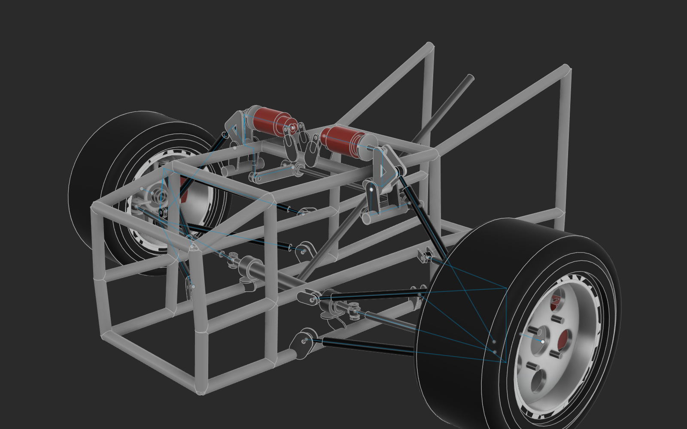

# FSAE-class front suspension: summary

*Navy Robson, Mechanical Designer (engineering student). Independent design from public data only. Status: requirements, kinematics, loads and CAD done (hardpoints v1.7). The detailed upright is designed as code, checked by FEA over all nine load cases and by Miner's rule over a duty spectrum, every bolt in the corner, the chassis-side joints included, is checked for fit and tool access, and the upright has a GD&T drawing. The BOM is costed. A DFMEA (23 failure modes) and a test plan (8 tests) say what would close every open item. The full write-up is [WRITEUP.md](WRITEUP.md). Next: Navy's own hand calcs on paper.*

*How it was made: Navy set the brief and the four main design choices and reviews each checkpoint. The analysis code, the Fusion 360 build scripts and the detailed technical decisions were produced with an AI coding assistant (Claude); every decision is recorded with its reason in [notes/requirements.md](notes/requirements.md).*

*CAD generated from `data/hardpoints.csv` and posed by the kinematic solver; ghost chassis is context only. The upright is the detailed, FEA-checked part. Rendered 2026-11-21: upright v4, the floating disc, the chassis-side tabs and the three-bar anti-roll bar.*

**Evidence chain:** requirements -> kinematics -> loads -> CAD + interference and fastener sweeps -> upright loads, detail design + FEA + fatigue -> GD&T drawing and costed BOM -> DFMEA and test plan (23 failure modes, 8 tests) -> write-up ([WRITEUP.md](WRITEUP.md)) -> **hand calcs on paper (next)**

## Headline numbers

| | Result | Target |
|---|---|---|
| Camber recovery in roll (outside wheel, 0.5-2 deg) | 61.9-62.6 % | 60-80 % |
| Bump steer over ±25 mm | 0.0001 deg, effectively zero (build-tolerance sensitivity: Week 3 study) | < 0.1 deg |
| Ackermann up to the steering stop (hairpin lock 21.9 deg + 0.5 deg) | 44-45 % | 40-60 % |
| Motion ratio over ±25 mm | 0.908-0.935 | 0.9-1.1 |
| Worst column buckling FoS (lower-arm rear leg, incl. rod-end shanks and the tyre's aligning moment) | 2.3 | >= 2.0 |
| CAD sweep, 279 poses of heave, roll, steer and warp: collisions / clearance warnings | 0 / 0 | 0 / 0 |
| Fastener sweep (every joint, chassis side included): washers, heads, nuts and thread inserts through the same poses, plus socket, spanner and insertion-path access | 0 FAIL; 8 WARN = bolt threads in bought parts to confirm with the makers (712 checks) | 0 FAIL |
| Tightest rim gap (rim lip to lower wishbone, full bump + full lock) vs the rim's worst-case tolerance stack | 6.3 mm in the CAD sweep (6.4 mm analytic) vs 5.6 mm | positive |
| Bump travel to the bump rubber / droop to the damper top-out | 28.1 / 27.0 mm | 25-30 / >= 25 mm |
| Anti-roll bar (three swappable bars, D26), stiff bar: full warp static / largest cornering roll in fatigue | FoS 2.11 / 1.58 | >= 1.5 |
| Hub bearing static safety, worst load case (upright free body) | 5.3 | >= 1.5 |
| Upright FEA, worst of nine load cases (combined braking + cornering): yield FoS | 2.30 (170 MPa) | >= 1.5 |
| The two ear roots the CAD tool left sharp (outside the FEA): a scripted hand-calculation method with Peterson's Kt, calibrated to the FEA | 1.78 | >= 1.5 |
| FEA peak change between the two finest meshes (still rising slowly: not asymptotic) / method vs beam theory (slender pin-loaded bar) | 2.0 % / 0.04 % | <= 5 % / <= 3 % |
| Upright fatigue, Miner's rule over a 3,000 km duty spectrum: factor on every stress | 3.24 | >= 1.5 |
| Upright fatigue screen (unlimited life at peak load) | 1.12 | accepted as deviation DV-3 |
| Upright, one piece | 0.778 kg | <= 0.6 kg: deviation DV-4 (the corner still meets its budget) |
| Hub spindle in rotating bending, Miner (with a shoulder ring and R3 fillet) | 1.94 | >= 1.5 |
| Member-end welds / rod-end threads in fatigue, Miner (IIW FAT 36 root, EN 1993-1-9 detail 50) | 3.2 / 3.0 | >= 1.5 |
| Steering free play at the wheel (assumed clearances; measured in the test plan) | 2.7 deg | < 7 deg |
| Parts cost, one corner / the front axle (estimated, 7 items still to quote) | about 3,570 / 8,000 USD | - |
| Unsprung mass per front corner | 10.21 kg | <= 11 kg |
| Brake heat into the upright: the floating disc's titanium bobbins against the heat budget, at the worst assumed contact | margin 1.2 (estimate) | >= 1 |
| Chassis tabs and brackets, bending at the weld (HC-11) | FoS 1.8 | >= 1.5 |
| Drop link's lever-end bolt in single shear, at the ARB's largest torque (HC-12) | FoS 1.99 | >= 1.5 |
| ARB lever at its hub and its end (HC-12; 8 x 25 mm since D26) | FoS 2.40 | >= 1.5 |
| Pushrod force, 3 g bump: 3D solver vs a 2D closed-form method (scripted; same inputs: it checks the solver's maths) | 2741 N vs 2739 N | agree |
| FEA chain vs beam theory (cantilever benchmark) | within 0.7 % | within 2 % |
| FEA method vs closed form: a stress concentration (plate with a hole) / the cup seat (Lamé ring) | +0.5 % / +0.03 % | within 3 % / 1 % |

## How it is checked

- **One source of truth:** `data/hardpoints.csv` drives the kinematics, the loads and the CAD. The CAD meshes carry a fingerprint of every input, so the sweep refuses geometry built from anything else.
- **Requirements traced automatically:** [notes/requirements_matrix.md](notes/requirements_matrix.md) shows 64 pass, 4 accepted deviations, 1 action (a helper spring) and 1 retired; [notes/dfmea.md](notes/dfmea.md) says what closes each one. Every value is read from an analysis output (the notes beside them are written), and the FEA's items turn STALE if the geometry, loads or FEA code change after it ran.
- **Designed to real parts:** Öhlins TTX25 damper, Aurora rod ends and spherical bearings, SKF tapered-roller hub bearings, and a Wilwood PS-1 caliper from its published drawing.
- **The upright is code, and the FEA shaped it:** one script builds the solid for both the Fusion assembly and the FEA. The FEA loads it the way it is really loaded (pin pressure in every hole, tilted tapered-roller pressure on the seats), refuses to run if the loads do not balance, refines where a coarse pass found the stress, and is validated against beam theory. It drove every size: the bearing wall, a one-piece caliper plate (the caliper's offset twists separate lugs), the fillets, and a boss where an ear grazed the housing (a stress that kept growing with the mesh gave that away).
- **Deviations and open items:**
  - Roll-centre migration above ground misses its target (35 vs 15 mm). No wishbone layout or chassis width tried reaches the target: the trade study's best is about 27 mm, and this design, its upper pickups also held to the assumed chassis's width with the rim's clearance at full lock, sits at 35 mm. If only the front roll centre moved, the effect would be about ±2 points of front balance. Recorded as deviation DV-1, not redefined away.
  - Two plan targets that conflicted (ride frequency vs roll gradient) were resolved by a recorded requirement change.
  - The upright is 0.778 kg against a 0.6 kg target set before the hub bearings had to grow. It is recorded as deviation DV-4, not a moved target.
  - Brake heat (S-16) passes on an estimate only: the floating disc's titanium bobbins hold the upright under its limit even at the worst contact assumed (margin 1.2), but the convection and contact values are assumptions, so a housing temperature test is in the plan.
- **Caught and fixed (each in [notes/hardpoint_log.md](notes/hardpoint_log.md)):**
  - a pushrod mount that steering would have twisted beyond its rod-end rating;
  - an optimistic buckling method;
  - a tie rod 4.6 mm from a wishbone leg;
  - a rim that hit the wishbones at full lock (fixed with a 6 in rim and a rim-clearance-constrained re-optimisation);
  - no room for a bump rubber;
  - an anti-roll bar too soft for its blades and too weak in warp, and later an adjustment by blades that could not work with a bolted drop link (three swappable bars since D26);
  - a brake caliper model that overlapped the hub;
  - a bracket stress figure that was wrong by a factor of two;
  - hub bearings overloaded in cornering (static safety 0.69), found by the first upright free body and fixed with a tapered-roller pair;
  - a lower ball-joint bolt bending past yield (fixed with a 3/8 in bolt and a bigger joint);
  - a layout-sized upright at over 600 MPa (now 170 MPa);
  - FEA loads that did not balance, a reaction check that could never fail, and an FEA run that needed 12 GB (all found by an independent code review or by the run itself, and fixed);
  - a rod end in the data that does not exist (the rating belonged to the AM-M8T), found by pricing the BOM;
  - a hub spindle that passed its fatigue check by only 1 % (now a shoulder ring with an R3 fillet);
  - a hand-calc model that read 50 % low against the FEA, now calibrated to it (found by an independent code review of the hand calcs);
  - a lower ball-joint thread insert that could not fit its 6 mm ear, and a bolted upper clevis whose bolts no key could reach: found by a fastener sweep that puts every washer, head, nut, insert and tool into the CAD sweep. Fixed with a short Heli-Coil in a small boss and a one-piece upper clevis, with camber now set at the wishbone's chassis rod ends; a bigger boss for the first insert had come within 2.9 mm of the pushrod's rod end;
  - gaps in that sweep's own bookkeeping (two washers sharing one result, a tool buried inside a part reading as clear, and a mesh that point-in-solid tests could not trust), found by an independent code review and fixed before its result was used;
  - a disc on a solid steel hat that would have passed its heat into the hub and bearings (now a floating disc on titanium bobbins), and nylon-insert lock nuts where the rules' 80 C limit would not hold;
  - in the final wide audit: an anti-roll-bar fatigue check without the reliability factor the upright's check uses (the bar is now 4340 at 180 ksi with 25 mm splined ends), toe that could only be set in half-turn steps (a left-hand rod end now makes each tie rod a turnbuckle), and test-plan methods that could not measure what they claimed;
  - chassis tabs that bent too far or clashed in their first layouts, a pedal-box keep-out that overlapped the assumed chassis itself, and wishbone bolts no socket could reach beside their rail: found by the strength check, the sweeps and a code review before or at the first build, and fixed.

  The analysis defects and key clearances have regression tests; the full CAD sweep re-runs with `run_all.py`.
- **Drawn and costed:** the upright's GD&T drawing ([drawings/FS1-UPR-001.pdf](drawings/FS1-UPR-001.pdf)) is generated from the same solid the FEA meshed, with datums on the bearing axis, the rib and the lower ball-joint hole and a hole table for the compound-angle holes; the BOM ([notes/bom.md](notes/bom.md)) prices every part with its source.
- **Checked:**
  - 243 automated test cases;
  - the hand-calculation checks (HC-1 to HC-12) are scripted answer keys; Navy's paper versions are still to do, so none is claimed as checked by hand;
  - FSAE rule references checked against the official 2026 rules (version 1.0);
  - an AI code review;
  - independent AI audit agents at each milestone, every finding re-checked before acting (some were rejected, such as a wrong rim-width claim);
  - every joint's misalignment over the full heave x roll x steer envelope.

## Decisions

See [notes/requirements.md](notes/requirements.md) s1. Each decision lists its reason and the alternatives rejected.

## What I'd do next (beyond this project)

- Strain-gauge the pushrod on a test rig and correlate with the model.
- A quarter-car model to choose damping, and steering effort against lateral g.
- Design the chassis, so the pickup widths and the roll-centre deviation can be revisited.
