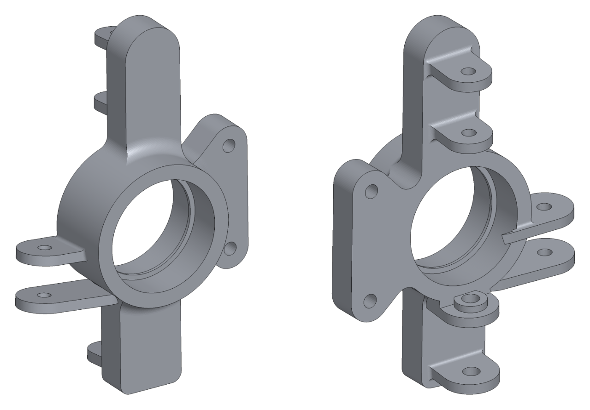
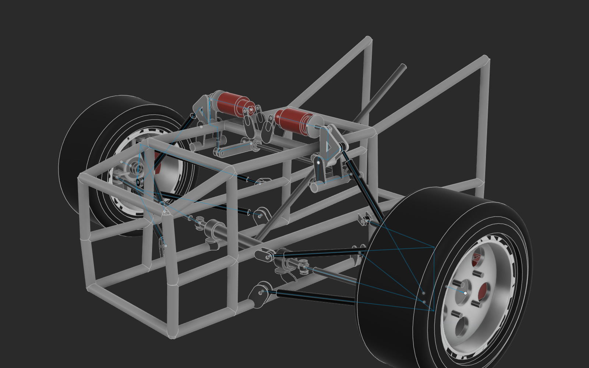
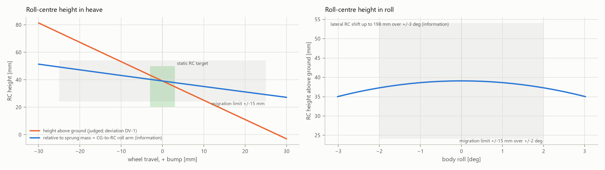
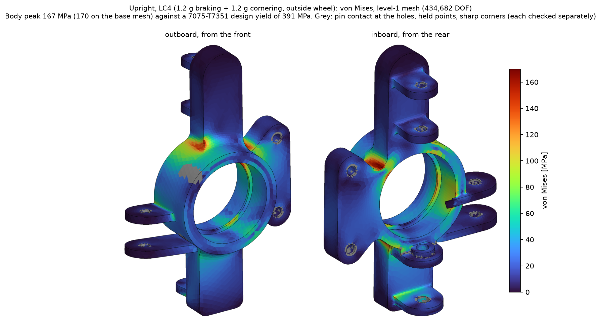
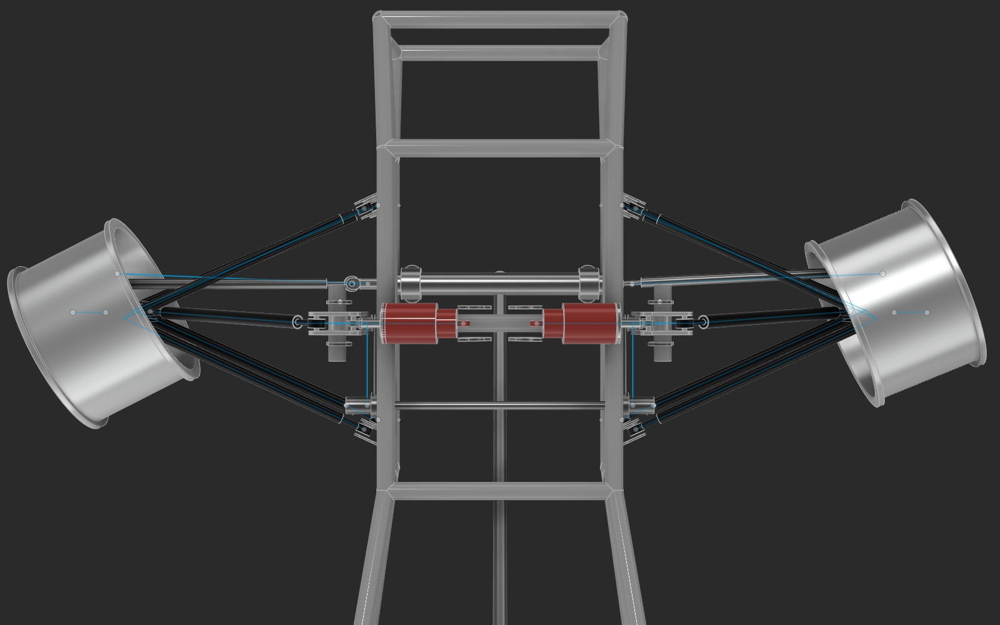

<!-- Generated by scripts/writeup.py from notes/writeup_template.md: edit the template, not this file. -->
# FSAE-class front suspension: design and verification

*Navy Robson, Mechanical Designer (engineering student). Independent design from public data only: no team data, hardpoints or CAD.*

*How it was made: I set the brief and the four main design choices and reviewed each checkpoint. The analysis code, the Fusion 360 build scripts and the detailed technical decisions were produced with an AI coding assistant (Claude); every decision is recorded with its reason in [notes/requirements.md](notes/requirements.md).*

*The upright from outboard (left) and inboard (right): one machined 7075-T7351 part, 0.778 kg, shaped by the FEA. Rendered from the same STEP the FEA meshes and the drawing is made from.*

## The brief

A front suspension for an FSAE-class car, from requirements to drawings, where every number can be traced to the file that produced it. The scope is the whole system past the chassis, both front corners:

- wishbones with spherical rod ends;
- a pushrod, a rocker and an inboard coilover (Öhlins TTX25);
- an anti-roll bar;
- the steering linkage to a Kaz rack;
- the upright, the hub and its bearings, the brake (a Wilwood PS-1 caliper on a floating disc);
- the tabs and brackets that join all of this to an assumed chassis.

The chassis itself is context only.

The car is my own reference vehicle, inside published FSAE ranges:

- 1550 mm wheelbase, 1220 mm front track;
- 290 kg with a 68 kg driver, 47 % on the front, CG at 290 mm;
- 10 in wheels on 16 x 7.5-10 tyres, no aero.

The targets came from public practice. The main ones:

- camber recovery in roll 60-80 %;
- bump steer < 0.1 deg toe change;
- a roll gradient of about 1.0 deg/g (0.9-1.1);
- 52 % of the total lateral load transfer at the front (TLLTD, which sets the handling balance);
- a front ride frequency of 2.8 Hz +/-5 %.

That last one is lowered from 3.2 Hz by a recorded requirement change (RC-2), because the roll and ride targets conflicted.

*The CAD is generated from one hardpoint file and posed by the kinematic solver. The grey frame is context, not designed.*

## Architecture, and why

- **Pushrod to a rocker and an inboard coilover.** This takes the spring and damper off the wheel (less unsprung mass), lets the motion ratio be designed (0.908-0.935 over ±25 mm, rising 2.02 %), and gives the anti-roll bar a clean place to connect.
- **10 in wheels.** They are lighter, but they make the upright, bearings and brake hard to package; that packaging is most of the work.
- **The upright is code.** One script builds the solid for both the Fusion assembly and the FEA, so the part analysed is the part drawn. There is one exception: two ear roots the CAD kernel could not fillet are sharp in the FEA and carry an R2 radius on the drawing, so they are checked separately.
- **Real parts throughout:** Öhlins TTX25 damper, Aurora rod ends and spherical bearings, SKF 32008 X tapered-roller hub bearings, and a Wilwood PS-1 caliper taken from its published drawing.
- **An anti-roll bar set by the bar.**
  - **The design:** three solid 4340 bars (10.2 / 12.4 / 13.9 mm), swapped to adjust, between stiff levers.
  - **Why not blades:** an earlier design adjusted the rate with rotating blades, which could not work. Rotating a blade would turn the bolted drop link past its rod end's rating. A blade soft enough to set the rate would also be overstressed in warp (one wheel at full bump, the other at full droop).

## Kinematics

| | Result | Target |
|---|---|---|
| Static camber / caster / kingpin inclination | -1.25 / 5 / 7 deg | -1.0 to -1.5 deg / 3-6 deg / 4-8 deg |
| Scrub radius / mechanical trail | 16.5 / 15 mm | 0-20 mm / 10-20 mm |
| Camber recovery in roll (outside wheel, 0.5-2 deg) | 61.9-62.6 % | 60-80 % |
| Bump steer over ±25 mm | 0.0001 deg (effectively zero) | < 0.1 deg toe change |
| Ackermann, 5 deg to the stop | 43.8-45 % | 40-60 % |
| Front roll-centre height / its movement in roll | 39.1 / 1.39 mm | 20-50 mm / < +/-15 mm |
| Roll-centre movement in heave above the ground, ±25 mm | **35.2 mm** | < +/-15 mm: **deviation DV-1** |
| Ride frequency / roll gradient at the middle bar | 2.91 Hz / 0.995 deg/g | 2.8 Hz +/-5 % / about 1.0 deg/g (0.9-1.1) |

*Left: the front roll centre's height above the ground (judged, DV-1) and relative to the body, over the wheel travel. Right: in roll its height stays within 1.39 mm; its sideways shift (116 mm over ±2 deg) is reported for information.*

**The one kinematic miss is roll-centre movement in heave.** It is judged above the ground, as the plan set it: 35.2 mm over ±25 mm against < +/-15 mm. It stays a failed requirement (deviation DV-1), not a redefined one.

- **No layout tried reaches the target.** Across the trade study (run on hardpoints v1.6; v1.7 moved only the damper's chassis eye), the best migration stays between 26 and 29 mm at any camber recovery from 39 to 81 %, even with the upper pickups 270 mm out. This design sits at 35 mm because its upper pickups are also held to the assumed chassis's width, with the rim's clearance at full lock. At that width no geometry tried does better, and each extra 10 mm of pickup width buys only about 1 mm. The target, as set, cannot be met within these constraints.
- **Relative to the body it moves 10.2 mm.** That is the change in the CG-to-roll-centre arm, which is what drives the load transfer.
- **The effect is a sensitivity, not a prediction.** If only the front roll centre moved, with the rear assumed fixed, the front's share of the load transfer would range from 49.9 % to 54.1 % over ±25 mm. In braking pitch the rear moves the other way and adds to it. A tilt-table test at two ride heights is planned to measure it.

## Loads

- **Load cases** (`data/loadcases.csv`):
  - 3 g bump (3 x static corner load);
  - 1.6 g cornering, outside wheel, and the inside wheel;
  - 1.5 g braking;
  - 1.2 g braking + 1.2 g cornering, outside wheel (envelope: about 10 % beyond the friction ellipse);
  - pothole edge strike: 3 x static corner load at 45 deg, through the wheel centre, brakes off;
  - kerb strike: 2.5 x static corner load inboard on the outer sidewall, 100 mm up, plus static weight;
  - 1.0 g reverse braking (car rolling backwards);
  - the steering effort with the wheels blocked (LC6).
- **What the cases leave out.** No case combines a bump with cornering, and no dynamic factor is applied. The margins cover that judgement, and the pushrod strain gauges in the test plan will check it.
- **Member forces.** A 3D six-link solver gives the forces in every member. A separate 2D closed-form method on the 3 g bump agrees with it: pushrod compression 2741 N against 2739 N.
- **Member checks.** Every link passes:
  - tube yield (FoS 3.23);
  - column buckling with the slimmer rod-end shanks included (FoS 2.32);
  - the rod ends on their ultimate rating (6.06);
  - the ball joints on their limit rating (4.76).

## The upright

The upright started as a layout part at over 600 MPa. The FEA shaped its next two versions and the fastener sweep the fourth.

- **Method.** The FEA is open source: gmsh and scikit-fem, quadratic tetrahedra, 961,794 degrees of freedom on the base mesh. It loads the part the way it is really loaded:
  - pin-bearing pressure in every clevis and bolt hole;
  - tilted tapered-roller pressure on the cup seats;
  - the thrust on the central rib.
- **Fail-safes.**
  - Every solve stops unless the applied loads balance.
  - Every face a load case can load (each hole, both cup seats, both faces of the rib) has its area checked against the build record, within 5 %.
  - The mesh is refined where a coarse pre-pass found the stress.
- **Validation.**
  - The method matches beam theory on a slender pin-loaded bar to within 0.04 %.
  - It recovers a hole's stress concentration to about 0.5 % and a thick ring under bore pressure to within 0.03 %.
- **Mesh refinement.** The governing peak changed 2 % between the two finest meshes (166, 167, 170 MPa). It is still creeping up, not yet in the asymptotic range, so the peak carries that uncertainty; the FoS of 2.30 (target >= 1.5 on yield) allows for it.

*LC4 governs: 1.2 g braking + 1.2 g cornering, outside wheel (envelope: about 10 % beyond the friction ellipse). Its body peak is 170 MPa on the base mesh, FoS 2.30 on the design yield.*

*The plot is a re-solve on a mesh of the convergence study's level-1 size: peak 167 MPa, against 167 MPa in the study. The grey zones are kept out of the peak and checked separately:*

- *pin contact at the holes, checked by bearing stress;*
- *the held points (the patch on the outboard face is one of them);*
- *two sharp corners the CAD kernel could not fillet, checked by a hand-calculation method calibrated to the FEA (HC-7: FoS 1.78).*

What the FEA changed:

- the bearing housing's wall;
- one plate for the caliper mount instead of two lugs (the caliper's offset twisted separate lugs);
- the fillets;
- a boss where an ear grazed the housing. A stress that kept growing as the mesh got finer gave that one away.

Fatigue (7075 has no endurance limit):

- **Miner's rule:** over an assumed 3,000 km duty spectrum, the factor on every stress is 3.24. The S-N line is Shigley's estimate, with a machined-surface factor made for steels (commonly applied to 7075). Fretting at the bolted ear holes is not modelled; the DFMEA covers it.
- **Unlimited life:** the stricter screen, unlimited life at the peak cornering load, gives only 1.12. That is recorded as deviation DV-3. It is managed by a proof test and an inspection interval, and the interval stays a judgement until the measured load spectrum supports one.

Two more deviations:

- **DV-4, mass:** the part weighs 0.778 kg against its target (<= 0.6 kg), a target set before the bearings had to grow. The corner still meets its unsprung budget: 10.2 kg against <= 11 kg.
- **DV-2, no direct hand check:** the upright has no slender section, so the plan's hand-calc check of the FEA at a plain section cannot be made. The method's validation on the slender bar, the hole and the ring stands in for it now; a strain-gauged proof test in the test plan will check the part itself.

The part has a GD&T drawing generated from the same solid ([FS1-UPR-001](drawings/FS1-UPR-001.pdf)):

- datums on the bearing axis, the rib and the lower ball-joint hole;
- a hole table for the compound-angle holes.

## Fit, clearance and every bolt

- **CAD sweep.** The CAD is posed by the kinematic solver over 279 combinations of heave, roll, steer and warp, and every pair of parts is checked:
  - 0 collisions;
  - parts that move relative to each other stay apart by >= 5 mm moving, >= 3 mm inside the wheel (0 warnings): smallest 5.1 mm, and 3.4 mm inside the wheel.
- **Rim clearance.** The rim's tightest gap is its lip to the lower wishbone at full bump and full lock. The CAD sweep gives 6.3 mm. An analytic check of the same pair (`scripts/rim_clearance.py`: the barrel as a cylinder of assumed inner radius, the leg as a tube, the closest point refined) gives 6.4 mm; the two models agree within half a millimetre. The worst-case tolerance stack-up of every source of error is 5.6 mm (notes/requirements.md, section 6), so the parts stay apart even if every source goes the wrong way at once.
- **Fastener sweep.** Every washer, head, nut and thread insert goes through the same poses, with the socket, the spanner and the path to pull each bolt out: 0 failures over 712 checks.
- **What that sweep found:**
  - a thread insert that could not fit its ear;
  - a bolted clevis no key could reach;
  - wishbone bolts no socket could reach beside their rail;
  - a caliper bolt that engaged its thread by only 5.6 mm after the caliper mount grew during the FEA work.
- **The rules' joint requirements.** Every joint is locked positively (T.8.3), every bolt length comes from a schedule that leaves two threads past its nut (T.8.2.5), and every rod end is in double shear or captured (V.3.1.5). The rule numbers are checked against the official 2026 rules (version 1.0).
- **Open warnings.** The 8 remaining warnings are threads inside bought parts (the caliper's mount holes, the rack's mounting blocks) whose depths the makers do not publish.

*Top view at full lock and full bump: the pose where the rim comes closest to the lower wishbone.*

## Setup and adjustment

| Setting | Baseline | How it is adjusted |
|---|---|---|
| Camber | -1.25 deg | Upper wishbone's chassis rod ends: about 0.55 deg per turn of both, with the toe reset afterwards (each turn also moves toe about 0.4 deg, and the corner's height about 0.3 mm) |
| Toe | set on the alignment rig | Turn the tie-rod tube: it has a left-hand rod end at one end, so it works as a turnbuckle. About 2.4 deg per turn, set continuously; jam nuts lock it |
| Caster, kingpin inclination | 5 / 7 deg | Fixed by the pickups |
| Ride height | as designed (the hardpoints are at static ride height) | The coilover's threaded spring perch: about 1.1 mm at the wheel per mm of perch |
| Spring | 150 lb/in Hyperco on the TTX25 (2.91 Hz) | Spring swap; this rate is the softest sold for the TTX25 |
| Anti-roll bar | middle bar: front TLLTD 52.0 %, 0.99 deg/g | Swap the bar: soft 48.9 %, stiff 54.5 %; drop links off: 45.5 % |
| Bump steer | effectively zero as designed | Shims at the rack-end clevis if the built car needs them |
| Steering stop | the hairpin's lock + 0.5 deg | Fixed |
| Damping | not studied | TTX25 clickers (a quarter-car model is the next study) |

## What was caught and fixed

Most of the value is in what the checks found before anything was made. Each finding is in [notes/hardpoint_log.md](notes/hardpoint_log.md), with what it led to.

- **Kinematics and fit:**
  - a pushrod mount that steering would have twisted beyond its rod end's rating;
  - a rim that hit the wishbones at full lock (fixed with a 6 in rim and a re-optimisation inside the rim's clearance);
  - no room for a bump rubber.
- **Structure:**
  - hub bearings overloaded in cornering (static safety 0.69), found by the first free body of the upright and fixed with a tapered-roller pair;
  - a lower ball-joint bolt bending past yield;
  - a hub spindle that passed its fatigue check by 1 % (now a shoulder ring with an R3 fillet).
- **Brakes:**
  - a disc on a solid steel hat that would have passed its heat into the bearings (now a floating disc on titanium bobbins, margin 1.2 on an estimate);
  - nylon-insert lock nuts where the rules' 80 C limit would not hold.
- **Anti-roll bar:**
  - a first bar too soft for its blades and too weak in warp;
  - later, an adjustment by blades that could not carry a bolted drop link;
  - in the final audit, a fatigue check of the new bar without the reliability factor the upright's check uses. With it the bar failed, so it is now 4340 at 180 ksi with larger splined ends (FoS 1.58).
- **The checks themselves.** The analysis's own checks and independent code reviews found defects in the analysis, each fixed before its result was used:
  - FEA loads that did not balance, caught by the run's own equilibrium check;
  - a hand-calc model that read 50 % low;
  - a fastener sweep with gaps in its own bookkeeping;
  - a bar 26 mm longer in the analysis than in the CAD;
  - a risk table whose coverage check passed on stale results.

## Verification still to do

The design is checked by analysis; the car has not been built.

- **DFMEA.** It has 23 failure modes and says what would close each requirement that is not passing. The highest risk priority number is 540 before the planned actions and 150 after ([notes/dfmea.md](notes/dfmea.md)).
- **Test plan.** 8 tests:
  - alignment and a bump-steer gauge;
  - strain gauges on the pushrods to check the load model;
  - steering free play and stops (2.72 deg predicted, against < 7 deg at the steering wheel);
  - a proof test of one upright with strain rosettes, in a fixture that loads it as the car does, with the FEA to be re-run on the fixture's supports for the comparison. It is the direct check DV-2 lacks, and gives the baseline for the inspection interval (DV-3);
  - hub, housing and disc temperatures over an endurance-length run;
  - the anti-roll bar's rate per bar, and a tilt-table test of the load-transfer balance at two ride heights;
  - a fastener torque audit;
  - an inspection schedule.
- **Open items:**
  - A helper spring is still to be sourced: the main spring goes slack over the last 2.33 mm of droop.
  - The wheel studs are not detailed.
  - The brake's line pressure reaches about 98 bar in the combined case. It is still to be checked against Wilwood's rating, with the pad and fluid temperatures.
  - Fretting is not modelled under the press-fitted bearing cones or at the bolted ear holes.
- **Assumptions,** each marked where it is used:
  - the load cases and the duty spectrum;
  - the brake's contact conductances;
  - the anti-roll bar's spline Kt (stress-concentration factor).

## Status of the requirements

The status is generated from the analysis outputs:

- 64 pass;
- 4 accepted deviations (DV-1, DV-2, DV-3 and DV-4);
- 1 action (V-05, a light helper (tender) spring, BOM line D3, to quote);
- 1 retired.

None is open, failed or stale; `scripts/writeup.py` refuses to write this document otherwise ([notes/requirements_matrix.md](notes/requirements_matrix.md)).

The hand-calculation checks quoted here (HC-1 to HC-12, `notes/handcalcs/`) are scripted answer keys: closed-form methods, independent of the solver. Most are also independent of the FEA; HC-6 and HC-7 are calibrated to it. The same twelve packets are set for me to work on paper; until that is done, none of them is claimed as checked by hand.

## How to check it

- **`python scripts/run_all.py`** (35-45 minutes) rebuilds the analysis outputs from the data files and the committed CAD meshes.
- **These run separately**, each recording a fingerprint of its inputs:
  - the upright FEA and fatigue (`scripts/fea/`, about 1.5 hours together);
  - the LC4 plot;
  - the upright's geometry and drawing;
  - the Fusion build and renders.

  The matrix and this document refuse their results once they are stale.
- **The CAD meshes** carry a fingerprint of the hardpoints, the data and the build scripts, so the sweeps refuse meshes built from other inputs. The upright's STEP, generated separately, is fingerprinted by the FEA.
- **The regression tests** run with `pytest tests`.
- **This document** is generated from a template whose results are filled in from those outputs (`scripts/writeup.py`); its other figures (inputs, targets and history) are quoted from the data files and the decision log.

## What I'd do next

- Build and test: the test plan above, starting with the pushrod strain gauges and the upright proof test.
- A quarter-car model to choose damping, and steering effort against lateral g.
- Design the chassis, and with it revisit the roll-centre target.
